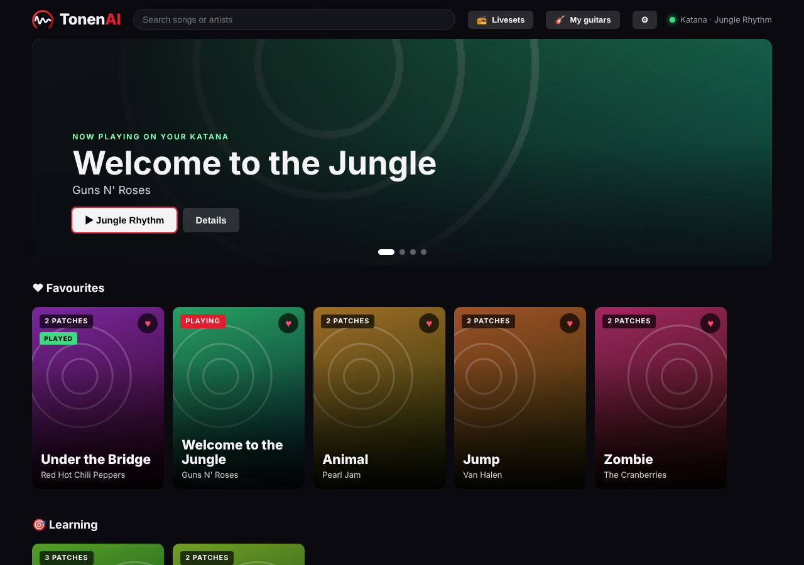
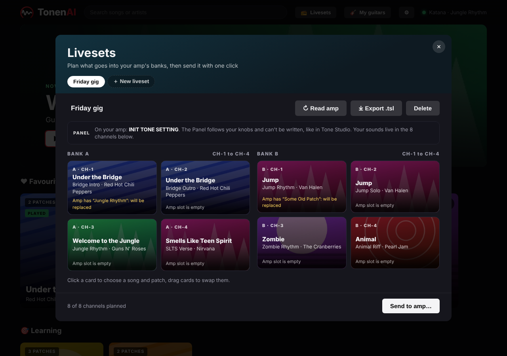
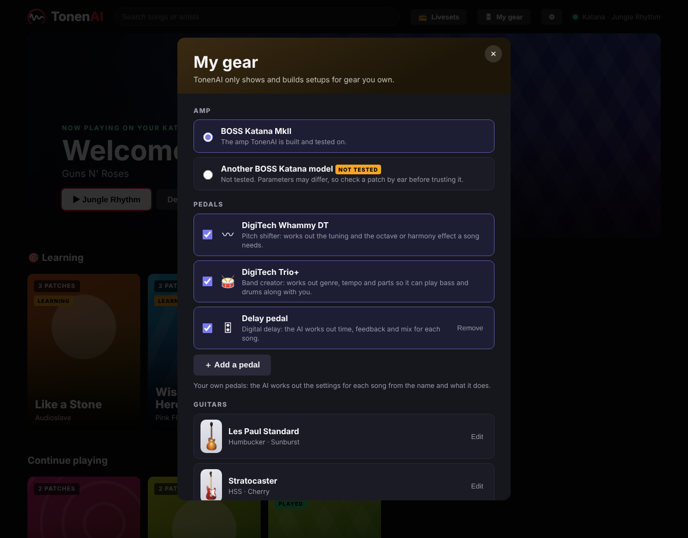
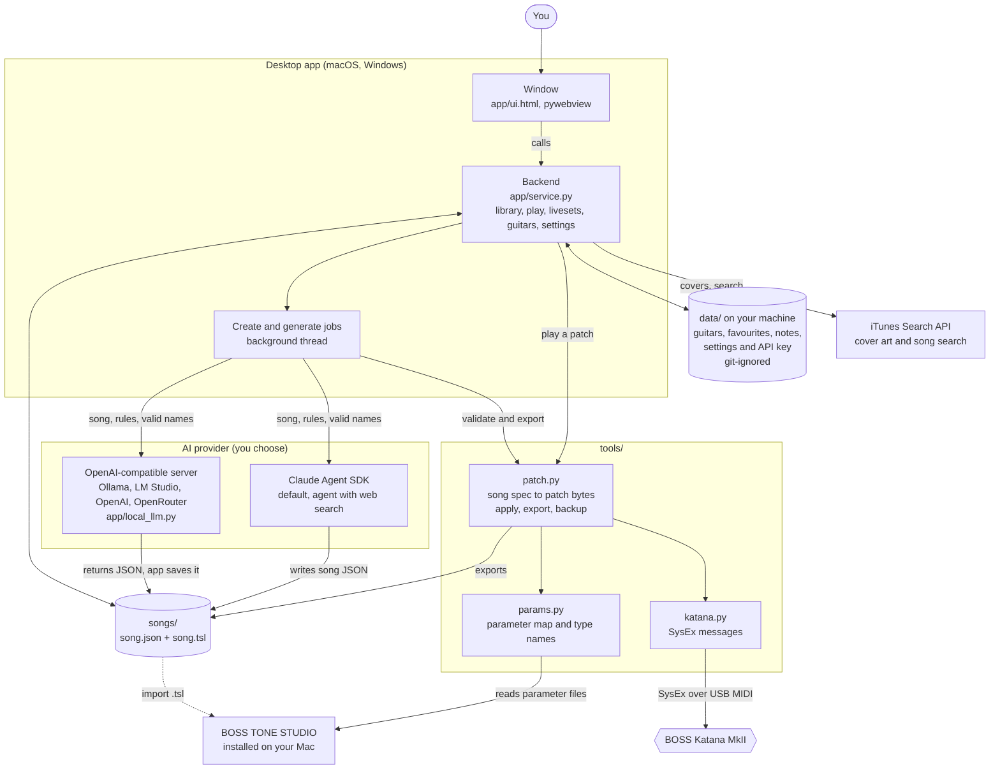
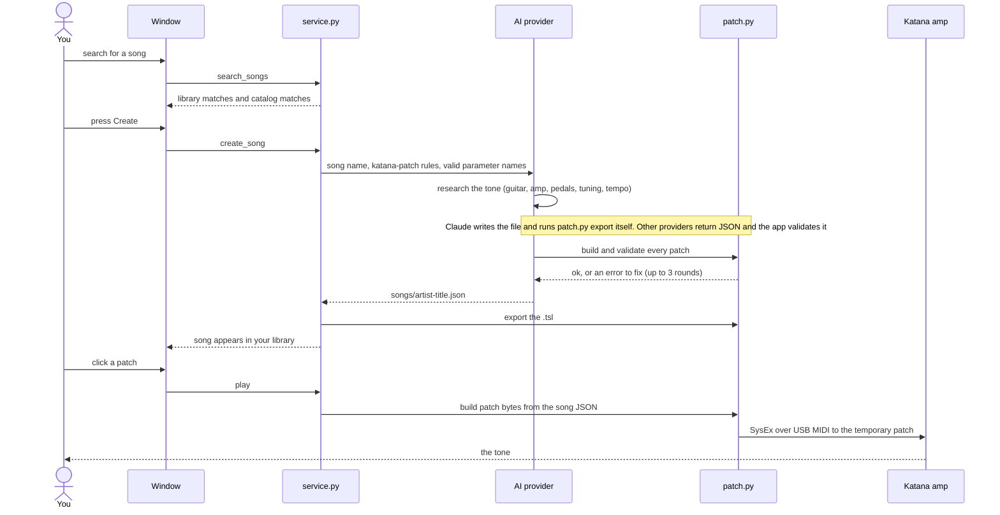

# TonenAI

Tell Claude a song or band; it builds a BOSS Katana MkII patch and applies it to the amp over USB MIDI,
or exports a `.tsl` liveset for BOSS TONE STUDIO. Includes a desktop app to browse your songs and send them to the amp.

> **Unofficial.** This project is not affiliated with, endorsed by or sponsored by BOSS or Roland. "BOSS",
> "Roland", "KATANA" and "TONE STUDIO" are trademarks of Roland Corporation, used here only to say which
> hardware and software this works with. Fender, Stratocaster, Telecaster, Jaguar, Gibson, Les Paul, SG, ES-335, Explorer,
> Flying V, PRS, Martin, Yamaha, Apple, iTunes, DuckDuckGo, Claude and Anthropic are trademarks of their respective owners,
> named only to describe guitar models or the services this app can use; no affiliation or endorsement is implied.
> Tones are informed approximations of how a song sounds, not copies.

**Status:** tested only on a Katana MkII. Other Katana models may or may not work; see Compatibility.

## Screenshots



| Livesets: plan the amp's banks | My gear: your amp, pedals and guitars |
| --- | --- |
|  |  |

*Screenshots use sample data and generated covers (the app draws one when a song has no artwork; no album art is included).*

## What is a `.tsl` file?
The file format BOSS TONE STUDIO uses to save a set of patches (a "liveset"; the name is inferred from the app,
BOSS does not spell it out). It is plain JSON: a name, format revision `0002`, the device name and each patch as lists
of hex bytes. Tone Studio's full backups use `.alb`.

## Compatibility
- Tested: Katana MkII. Likely: other MkII sizes. Unknown: original Katana (MkI), Gen 3, Air, Go, Artist.
- **macOS:** developed and tested here.
- **Windows 10/11:** supported but not yet tested on a real PC (the code paths are exercised with simulated Windows paths and
  port names). It needs Python 3.12+, the Microsoft Edge WebView2 runtime (already part of Windows 11 and most
  Windows 10 installs), the BOSS KATANA USB driver and BOSS TONE STUDIO for KATANA MkII. Please open an issue with what you see.
- **Linux:** not supported officially (there is no Tone Studio for Linux, so the parameter list cannot be built). PRs welcome.

## Quick start
**You need:** a Mac or a Windows PC, Python 3.12+, BOSS TONE STUDIO for KATANA MkII (free from BOSS)
installed in its default folder (macOS: `/Applications/BOSS/KATANA MkII/`; Windows: searched under Program Files, see below) and the KATANA USB driver. Keep Tone Studio installed: the app reads its parameter
files every time it starts (nothing from BOSS is copied into this repo). The amp must be on and connected over USB to play patches.
No amp yet? You can still browse, create and export `.tsl` files; only "send to the amp" needs it.

1. **Get the code and install**
   ```
   git clone https://github.com/fischerp/tonenai.git && cd tonenai
   python3 -m venv .venv && .venv/bin/pip install -r requirements.txt
   .venv/bin/python tools/extract_catalog.py tools/catalog.json    # builds the parameter names list from your Tone Studio
   ```
   On Windows (PowerShell), the same three steps are:
   ```
   git clone https://github.com/fischerp/tonenai.git; cd tonenai
   py -3 -m venv .venv; .venv\Scripts\pip install -r requirements.txt
   .venv\Scripts\python tools\extract_catalog.py tools\catalog.json
   ```
   Everywhere below, read `.venv/bin/python` as `.venv\Scripts\python` on Windows.
2. **Choose the AI that builds patches** (only needed for "Create"; browsing and playing existing songs works without it)
   - *Claude (default):* sign in once with `"$(.venv/bin/python -c 'import importlib.util as u, pathlib as p; print(p.Path(u.find_spec("claude_agent_sdk").origin).parent / "_bundled" / "claude")')" /login`
   - *Anything else:* open the app, click **AI** in the header and pick Ollama, LM Studio, OpenAI, OpenRouter or a custom URL (see [AI providers](#ai-providers)).
3. **Back up your amp** once: `.venv/bin/python tools/patch.py backup -o backups/before.tsl`. TonenAI only writes the amp's temporary (live) patch, but a backup is cheap.
4. **Start it:** `./run.command` or double-click `TonenAI.app` (macOS), or double-click `run.bat` (Windows). Search a song. If it is not in the library, press **Create**, wait about a minute, then click a patch to hear it.

**If something does not work**
- *"Katana not found":* amp off, cable or USB driver missing, or another app (usually BOSS TONE STUDIO) is holding the amp's MIDI port. Quit it and wait a few seconds.
- *`FileNotFoundError ... address_map.js`:* Tone Studio was not found. On macOS it must be in the default folder. On Windows the app
  searches the BOSS/Roland folders under Program Files and `%LOCALAPPDATA%\Programs`; if yours is elsewhere, set the environment
  variable `TONENAI_TONE_STUDIO` to its install folder (the search goes downwards from there; it only needs to find `js/config/address_map.js`).
- *Windows: "Katana not found" although the amp is on:* the port name differs by driver. Set `TONENAI_MIDI_PORT` to the exact name
  (list them with `.venv\Scripts\python -c "import mido; print(mido.get_output_names())"`).
- *"Claude is not signed in":* repeat the sign-in in step 2. For another provider, use **AI > Test connection**.
- *Created tone sounds off:* patches are informed approximations. Tweak by ear and check the guitar and pickup advice on the song page.

## How it works
A song goes in, a patch comes out. The app keeps the AI, your files and the amp in separate layers, so you can swap any one of them:



What happens when you create a song and play it:



| Folder | What lives there |
|---|---|
| `app/` | the desktop window (`ui.html`, `*.js`, translations in `i18n.js`) and the Python backend (`service.py`, `local_llm.py`) |
| `tools/` | amp protocol and patch building: `patch.py` (CLI too), `params.py`, `katana.py`, `extract_catalog.py` |
| `songs/` | your library: one `.json` spec and one `.tsl` per song, plus cached album covers (git-ignored) |
| `data/` | everything personal: your guitars, favourites, notes, settings, API key (git-ignored) |
| `.claude/` | the `katana-patch` skill (the rules the AI follows) and helper agents for contributors |

## Desktop app
```
Double-click TonenAI.app (keep it inside the project folder; drag it to the Dock if you like)
./run.command            # or from a terminal: .venv/bin/python app/main.py
```
**Opening:** the app starts with a short splash and an original TO-NEN-AI sting (a bass hit, then a guitar lick; `assets/tonenai-intro.wav`, played natively: `afplay` on macOS, `winsound` on Windows). Click or press any key to skip.

A visual library of your songs: click a song, pick a patch, it is sent to the amp. **Import .tsl** loads any Tone Studio liveset file into the library. Press Enter in the search box to see your library matches first, then other popular songs from the iTunes catalog (shown with **Create**); click any band name (on a card, the song page or a row title) to list all your songs by that band plus more of theirs you can add; the list length is **⚙ > Results per search** (default 10, `search_limit` in `data/settings.json`, 3-30). Search the library; if a
song is not found, **Create with Claude** researches the tone and adds `songs/<artist>-<title>.json` + `.tsl`.
One-time sign-in for that feature is in the Quick start above (the app uses the Claude Agent SDK bundled in the venv).
**My gear:** tell TonenAI what you own and it only shows and builds setups for that. Pick your **amp** (Katana MkII is the
tested one; other Katanas carry a "not tested" warning), switch your **pedals** on or off, and register your **guitars**.
The Whammy DT and Trio+ are on by default. Add any other pedal with **＋ Add a pedal** (a name and what it does): the AI then
researches the pedal once (summary, controls and ranges, MIDI, first-time setup, a watch-out note; shown as "Likely" or "Confirmed" until you check it, and you can remove wrong controls or research again), then uses that profile to work out its settings per song and checks them against the real controls. The song screen gets a tile for it. A pedal you switch off disappears from the song
screen and from what the AI is asked to write; the data stays in the song files. Your choices live in `data/rig.json`
(not in git). The built-in list is `gear/catalog.json`: add an amp or pedal there to offer it to everyone
(`{"id", "name", "short", "icon", "about", "default"}`; use `"kind": "whammy"` or `"trio"` only for the two built-in pedals,
any other pedal is generic and its setup is stored per song under `gear.<id>`).

**My guitars:** register the guitars you own (stored locally in `data/`, not in git). Each song lists the original
guitars and pickups used on the record (researched by Claude, with a confidence level) and ranks your guitars for it,
with the pickup position to use.

**My practice:** mark a song as **Learning** or **Played** and keep your own notes on it (stored locally in `data/song_meta.json`). Songs you are learning get their own row on the home screen.

**Also per song (for the pedals you own):** Trio+ band setup (genre, BPM, click track, steps), Whammy DT setup (tuning, when to use it) and a setup card for every pedal you added.

**Language:** English, Português (Brasil) and Español. Pick it from the flag list in the header; the first launch follows your system language and the choice is remembered (`data/settings.json`). In Portuguese or Spanish, songs created with Claude get their notes and tips written in that language too. To add a language, add it to `LANGS` and `I18N` in `app/i18n.js` (and to `LANG_NAMES` in `app/service.py`).

UI dev without the amp: `python3 -m http.server 8765` then open `http://localhost:8765/app/preview.html` (mock amp).

## AI providers
Click **AI** in the app header and pick a card, then **Save**:
- **Claude** (default): uses your Claude sign-in, nothing else to set up.
- **Ollama** or **LM Studio** (free, runs on your computer): the app checks the server for you and lists the models you have installed. If Ollama is not installed it tells you the one command to run.
- **ChatGPT / OpenAI** or **OpenRouter**: paste an API key, press **Connect**, choose a model from the list. Note that a ChatGPT subscription is not an API key: create one at platform.openai.com/api-keys (pay per use).
- **Other server**: any OpenAI-style URL (type the URL under the card).

Everyone connects their own account: nothing is shared or bundled. The key belongs to the server it was entered for and is dropped if you switch to another one.

The choice is stored in `data/settings.json` (git-ignored, file mode 600; the API key is never sent back to the UI):
```
{"lang": "en", "provider": "openai",
 "openai": {"preset": "ollama", "base_url": "http://localhost:11434/v1", "model": "qwen2.5:14b-instruct", "search": "duckduckgo"}}
```
Optional keys: `api_key`, `timeout` (900 s), `retries` (3). Environment overrides: `TONENAI_PROVIDER=claude|openai`, `TONENAI_API_KEY`.

How the other providers work: this is not an agent loop like the Claude path. The model gets the skill text, the valid type names and an
example song, returns JSON, and the app validates it against the Katana tables, feeding errors back for up to `retries` rounds. Research is a
best-effort DuckDuckGo snippet search (switch it off in the AI dialog), so smaller models guess more about gear, tempo and tuning; they are told
to mark unverified facts `unknown`. For Ollama, `ollama pull qwen2.5:14b-instruct` first and give the server at least 8k context.

## CLI
```
.venv/bin/python tools/patch.py apply songs/gnr-welcome-to-the-jungle.json      # live, to the amp's temporary patch
.venv/bin/python tools/patch.py export songs/gnr-welcome-to-the-jungle.json -o out.tsl
.venv/bin/python tools/patch.py backup -o backups/current.tsl # save what the amp has now
```

## Findings (verified on a real Katana MkII)
- SysEx header `F0 41 <devid> 00 00 00 33`; device id comes from the identity reply (00 here), not 10.
- Send DT1 `7F 00 00 01` = 1 (editor mode) before reading/writing.
- Temp patch lives at `60 00 00 00`; panel amp type N (Acoustic..Brown = 0..4) sets preamp type 28+N.
- Parameter layout and option names are read from the installed Tone Studio bundle (`tools/params.py`).

## Developer: regenerating the guitar outlines
`tools/trace_guitars.py` re-creates `app/guitar-shapes.js` from reference photos (download them into `/tmp/mkprev/ref/` first;
file names are listed in the credits above). Needs `pip install opencv-python-headless numpy`, then `EXPORT=1 python tools/trace_guitars.py`.

## Roadmap
- Guitar/pickup profile so Claude tunes EQ per guitar; package as a double-click `.app`.
- Optional: tag songs (played / learning), notes, export selection as one `.tsl` liveset.

## Credits and data sources
- Guitar pictures in My guitars are original vector illustrations drawn for TonenAI. The **body outlines** of seven models
  (and a few pickguard shapes) were traced from silhouettes of photographs on Wikimedia Commons with `tools/trace_guitars.py`
  (needs OpenCV; only vector paths in `app/guitar-shapes.js` ship, no photo pixels): Fender Stratocaster 004-2 (public domain),
  Fender Telecaster American Vintage 1952 (CC BY-SA 3.0), Full front R9 Les Paul (CC BY-SA 4.0), Iommi SG (CC BY-SA 2.0),
  1960 Gibson ES-335TD (CC BY-SA 4.0), Fender Jaguar 3 tone burst (CC BY-SA 4.0), PRS Custom (1988) Santana (CC BY-SA 4.0).
  Gibson Explorer dark red (CC0) was traced for the Explorer, Martin D-28 Acoustic Guitar (CC BY-SA 4.0) for the Dreadnought, Yamaha Acoustic Guitar FG-331 (CC0) for the Concert/OM and Classical Guitar (CC BY-SA 3.0) for the Classical. The Les Paul outline was redrawn by hand from measurements of the traced shape; the Flying V outline is hand-drawn. Credit and share-alike apply to `app/guitar-shapes.js`.
- Album art and song search use data provided by Apple's public iTunes Search API; covers are downloaded to a local cache for your own
  use and are not part of this repo. Artwork belongs to its respective owners.
- Optional web research for local models uses DuckDuckGo's HTML results (best-effort snippets, no API; can be turned
  off under AI provider, "Web research").
- The opening sting (`assets/tonenai-intro.wav`) was synthesized for this project with Claude's help; it contains no
  samples or third-party recordings and is covered by the project licence.
- Create with Claude uses the Claude Agent SDK; each user signs in themselves or supplies their own API key.
- Amp parameter layout was learned from the installed BOSS TONE STUDIO app and from testing on real hardware, for
  interoperability.

## Safety
Patches are written to the amp's temporary (live) patch, not to its memory slots, and power-cycling restores
your stored sounds. Still, back up first (`patch.py backup`) and use at your own risk; see the license.

## License
[PolyForm Noncommercial 1.0.0](LICENSE): free for personal, hobby, educational and other noncommercial use, and you
may change and share it under the same terms. **Commercial use (selling it, bundling it in a paid product or service)
needs a separate written licence from the author**; get in touch to agree terms. Exception: `app/guitar-shapes.js` is
derived from CC BY-SA works and stays under the share-alike terms of those licences, which allow commercial use of
that file (see Credits and data sources).

This is source-available rather than "open source" in the OSI sense. TonenAI is an independent project and is not
affiliated with or endorsed by BOSS, DigiTech or Anthropic.
